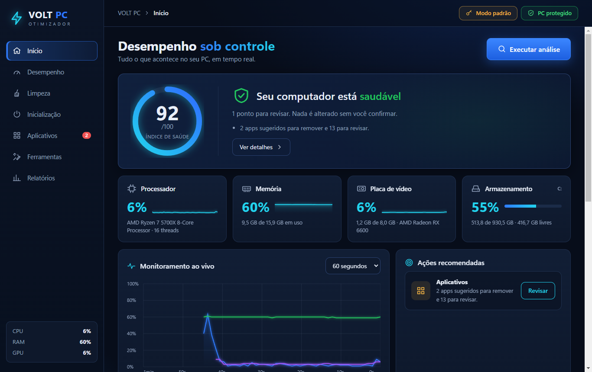
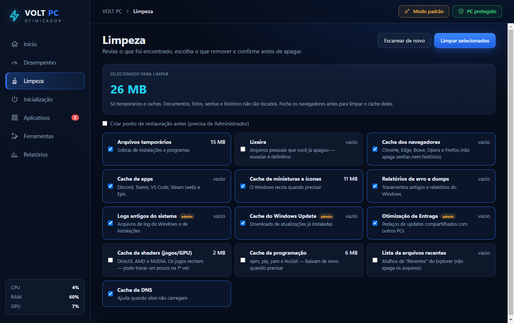

# ⚡ VOLT PC Otimizador

Aplicativo desktop para **Windows 10 e 11** que mostra como o seu PC está em tempo real e ajuda a deixá-lo mais leve: limpa arquivos temporários, controla o que abre com o Windows, aponta aplicativos desnecessários e monitora processador, memória, placa de vídeo e disco.

Feito com **Electron + Node.js + PowerShell**, sem nenhuma biblioteca de interface.



## Princípios

- **Dados reais.** Todo número da tela é lido do próprio Windows. Quando um dado não está disponível, o app mostra "Indisponível" em vez de inventar um valor.
- **Nada acontece sem você.** Analisar não muda nada. Apagar, desinstalar, desativar ou finalizar só acontece depois de você marcar e confirmar numa janela que lista o que vai mudar.
- **Sem otimizações mágicas.** Não tem "limpeza de registro", "turbo" nem promessas de velocidade. Só ações conhecidas e explicadas.
- **Reversível quando possível.** O histórico mostra "Desfazer" apenas onde existe reversão real.
- **Sem Administrador por padrão.** O app abre no modo normal e só pede permissão quando uma função realmente precisa.

## O que ele faz

| Tela | Para que serve |
|---|---|
| **Início** | Índice de saúde de 0 a 100, uso atual de CPU, memória, placa de vídeo e armazenamento, gráfico ao vivo (60 s, 2 min ou 5 min), ações recomendadas e data da última análise. |
| **Executar análise** | Verifica 7 categorias: arquivos temporários, inicialização, aplicativos, armazenamento, memória, tempo ligado e proteção (Microsoft Defender). Cada uma mostra o **impacto esperado** e **o que muda** se você agir. O botão "Revisar" leva à tela certa. |
| **Desempenho** | Gráfico de CPU, memória e GPU e lista dos processos que mais consomem, com busca e ordenação. "Finalizar" pede confirmação e explica o efeito. Processos do sistema ficam bloqueados. |
| **Limpeza** | Mostra o tamanho de cada categoria antes de apagar: temporários, Lixeira, cache de navegadores (Chrome, Edge, Brave, Opera, Firefox), cache de apps (Discord, Teams, VS Code, Steam, Epic), miniaturas, relatórios de erro, logs, Windows Update, Otimização de Entrega, shaders, cache de programação (npm, pip, yarn, NuGet), recentes e DNS. Documentos, fotos, senhas e histórico dos navegadores nunca são tocados. |
| **Inicialização** | Programas que abrem com o Windows, com nome, editor e estado. Ligar ou desligar é reversível na hora (botão "Desfazer"). Itens essenciais do Windows ficam bloqueados. |
| **Aplicativos** | Classifica o que está instalado. 🔴 **Remover**: propaganda, trials e "otimizadores" duvidosos. 🟡 **Revisar**: versões duplicadas, apps enormes ou antigos. 🔵 **Sistema**: drivers e runtimes, bloqueados. O botão **Abrir local** mostra a pasta de cada app antes de você decidir. Jogos de launcher (Steam, Epic, Riot e outros) são enviados ao próprio launcher, onde você confirma. |
| **Ferramentas** | Modo Jogo (plano de energia máximo, fecha os programas que você escolher e libera RAM; ao desativar volta o plano anterior), liberar RAM, ponto de restauração, Restauração do Sistema e atalho para a Segurança do Windows. |
| **Relatórios** | Resultado da última análise e histórico de tudo que o app fez (data, ação e resultado), com "Desfazer" onde é possível. |



## Como funciona por dentro

```
Interface (index.html + renderer.js)
        │  só envia IDs e nomes, nunca comandos
        ▼
preload.js ── ponte segura (contextIsolation)
        │
        ▼
main.js ── processo principal: confirmações, histórico, permissões
        │
        ▼
powershell.js ── executa os scripts e devolve JSON
        │
        ▼
scripts.js ── scripts PowerShell de leitura e de cada ação
```

- A interface nunca monta comandos. Ela pede, por exemplo, "limpar o item `temp`", e o processo principal decide o script, mostra a confirmação e registra no histórico.
- CPU e memória vêm do Node.js (`os`). A placa de vídeo vem dos contadores de desempenho do Windows (`GPUPerformanceCounters`), lidos por um PowerShell que fica aberto em segundo plano.
- Desativar um item de inicialização usa a mesma chave do Gerenciador de Tarefas (`StartupApproved`), então dá para reativar a qualquer momento.
- O histórico e a última análise ficam em `%APPDATA%\Otimizador PC\estado.json`, e os erros em `erros.log` na mesma pasta.

## Como rodar

Pré-requisito: [Node.js](https://nodejs.org) 18 ou mais novo.

```bash
git clone https://github.com/felipe-deev/otimizador-pc.git
cd otimizador-pc
npm install
npm start
```

> Se você rodar pelo terminal do VS Code e a janela não abrir, rode antes `Remove-Item Env:ELECTRON_RUN_AS_NODE` no PowerShell. O VS Code define essa variável e ela faz o Electron rodar como Node.

## Gerar o executável

```bash
npm run build
```

Os arquivos saem na pasta `programa/`:

- `programa/Otimizador PC Setup 1.0.0.exe`: instalador, que cria atalho na Área de Trabalho e no Menu Iniciar.
- `programa/win-unpacked/Otimizador PC.exe`: versão que abre direto, sem instalar.

O app não tem assinatura digital, então o Windows pode mostrar "O Windows protegeu o computador". Clique em **Mais informações → Executar assim mesmo**.

### Problemas comuns no build

- `Cannot create symbolic link ... winCodeSign`: extraia o cache sem a pasta de macOS:

  ```powershell
  $c="$env:LOCALAPPDATA\electron-builder\Cache\winCodeSign"
  $z=Get-ChildItem $c -Filter *.7z | Select -First 1
  & .\node_modules\7zip-bin\win\x64\7za.exe x $z.FullName "-o$c\winCodeSign-2.6.0" -y -x!darwin
  ```

- `app.asar ... being used by another process`: feche o app e qualquer aba do VS Code que esteja com um `.asar` aberto. O build atual usa `asar: false` justamente para evitar isso.

## Permissões

Funciona **sem** Administrador: análise, monitoramento, limpeza das pastas do usuário, inicialização do seu usuário, aplicativos da Microsoft Store e Modo Jogo.

Precisa de **Administrador**: limpar pastas do Windows (logs, Windows Update, Otimização de Entrega), criar ponto de restauração e alterar itens de inicialização de todos os usuários. Nesses casos o app avisa e oferece **Ferramentas → Reiniciar como administrador**.

## Limitações conhecidas

- Temperatura de CPU e GPU não é exibida, porque o Windows não fornece esse dado de forma confiável sem driver de terceiros.
- Limpeza e desinstalação não podem ser desfeitas pelo app. Para isso existe o ponto de restauração, que é opcional antes de cada ação.
- O uso da placa de vídeo depende dos contadores do Windows. Em drivers ou máquinas virtuais que não os oferecem, aparece "Indisponível".

## Estrutura

```
src/
  main.js        processo principal (janela, confirmações, histórico, IPC)
  preload.js     ponte segura entre a interface e o sistema
  powershell.js  executa PowerShell e devolve JSON (também em modo contínuo)
  scripts.js     scripts de análise, limpeza, inicialização, apps e GPU
  index.html     estrutura das telas
  styles.css     tema visual
  renderer.js    lógica da interface, gráficos e análise
build/icon.png   ícone do app
docs/            imagens deste README
```

## Personalizar

As listas de bloatware e de itens protegidos ficam no topo de `src/scripts.js` (`BLOATWARE`, `PROTEGIDOS`, `RUIM`). As categorias de limpeza ficam em `ALVOS_LIMPEZA`, no mesmo arquivo.

## ⚠️ Aviso de uso

- Este app **altera o Windows**: apaga arquivos temporários e caches, desinstala aplicativos, muda itens de inicialização e o plano de energia. Cada ação mostra antes o que vai mudar e pede confirmação, mas **o uso é por sua conta e risco**.
- **Limpeza e desinstalação não podem ser desfeitas pelo app.** Antes de mudanças grandes, crie um ponto de restauração (Ferramentas → Ponto de restauração).
- Revise as sugestões antes de aceitar. "Remover" é uma sugestão baseada em nome e fabricante, não uma garantia de que o app é inútil para você. Use **Abrir local** para ver a pasta do app antes de decidir.
- Não há garantia de aumento de desempenho. O app só executa ações conhecidas e explicadas na tela.
- O software é fornecido "no estado em que se encontra", sem garantias. Veja a [LICENSE](LICENSE).

## Segurança

Encontrou uma falha de segurança? **Não abra uma issue pública.** Veja como reportar em particular na [Política de segurança](SECURITY.md).

## Licença

**Copyright © 2026 Felipe Borges de Lima. Todos os direitos reservados.**

O código está publicado apenas para consulta. Copiar, modificar, redistribuir ou usar este software, no todo ou em parte, depende de autorização prévia e por escrito do autor. Detalhes em [LICENSE](LICENSE).
